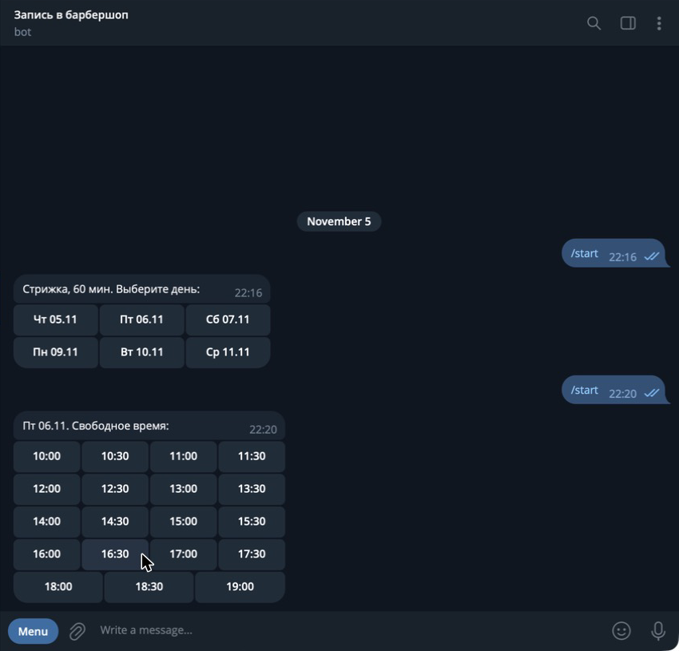
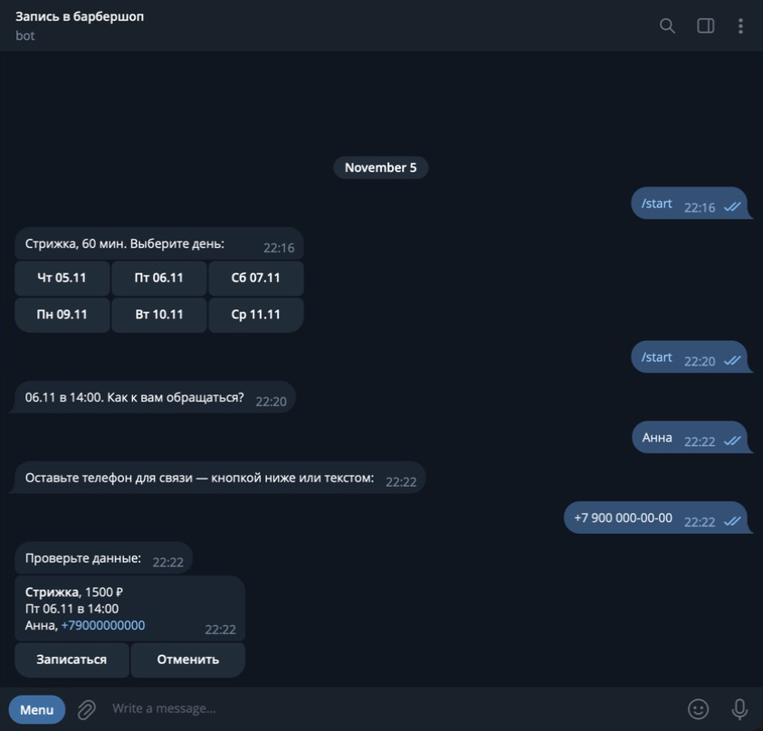
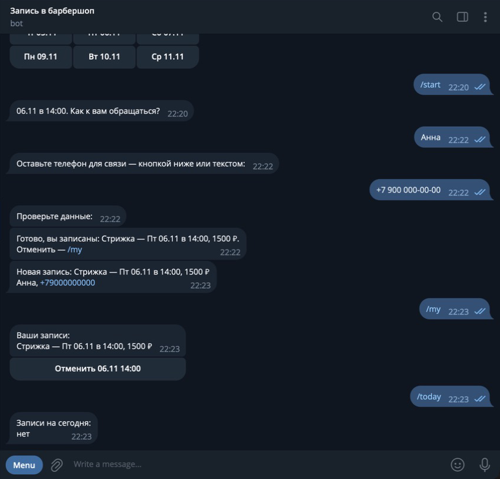

# Бот записи клиентов в Telegram

Демо-проект: Telegram-бот, через который клиенты сами записываются на услугу, например в барбершоп, салон или к мастеру. Звонить и переписываться для этого не нужно.

## Как это выглядит
| Выбор времени | Подтверждение | Запись, уведомление владельцу, «Мои записи» |
|---|---|---|
|  |  |  |

На скриншотах демо-данные. Владелец бота здесь сам выступает клиентом, поэтому уведомление «Новая запись» пришло в тот же чат.

## Что умеет
**Клиенту:**
- выбрать услугу, день и свободное время;
- оставить имя и телефон: кнопкой «Отправить мой номер» или текстом;
- посмотреть свои записи и отменить их (`/my`).

**Владельцу:**
- уведомление о каждой новой записи и отмене;
- список записей на сегодня (`/today`);
- услуги, цены и график работы меняются в `config/services.toml`, правка кода не нужна.

## Как устроено
- Свободные окна считаются с учётом длительности услуги и уже занятого времени, рабочих часов, выходных и минимального времени до начала. Записаться за 5 минут до начала нельзя.
- Два клиента не займут одно и то же время: пересечение проверяется в транзакции SQLite. Если окно заняли, пока клиент вводил телефон, бот предложит выбрать другое.
- Данным из кнопок бот не доверяет: перед записью он ещё раз проверяет, что время действительно свободно. Отменить чужую запись нельзя.
- Токен хранится только в `.env` и не попадает в git и логи.

Стек: Python 3.12+, [aiogram 3](https://docs.aiogram.dev/), SQLite. Тесты на `unittest`, сеть и Telegram для них не нужны.

```
booking_bot/
  schedule.py   — услуги, график, свободные окна, проверка телефона (чистая логика)
  storage.py    — записи в SQLite, защита от двойной записи
  handlers.py   — диалог в Telegram
  config.py     — настройки из окружения / .env
config/services.toml — услуги и график
tests/          — 29 тестов
```

## Запуск
```bash
python3 -m venv .venv
.venv/bin/pip install -r requirements.txt
cp .env.example .env        # впишите свой ADMIN_IDS
./scripts/set_token.sh      # скрытый ввод токена от @BotFather
.venv/bin/python -m booking_bot
```

Тесты:
```bash
.venv/bin/python -m unittest discover -s tests -t .
```

## Что можно добавить под задачу
Напоминания клиентам за день до визита, несколько мастеров со своим расписанием, выгрузку записей в Google Sheets, оплату.
